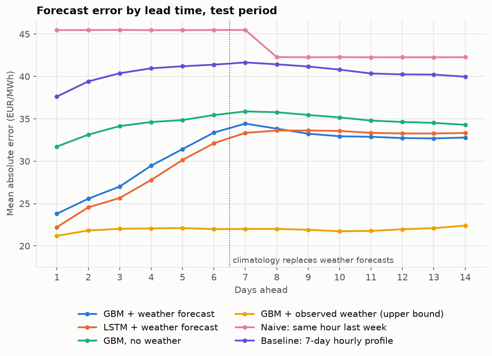
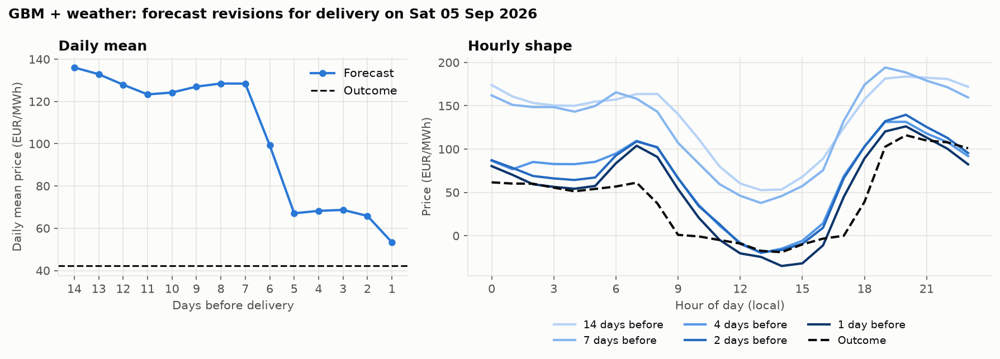

# Climate-Data-Project

Forecasting hourly day-ahead electricity prices up to two weeks ahead from weather,
and measuring how the forecast improves as newer weather forecasts arrive.

Current market: **Germany-Luxembourg (DE-LU)**. Everything market-specific lives in
`config/de_lu.yaml`.

## Results so far

Test period: forecasts issued daily from March to October 2026 (242 origins), models
trained on April 2024 to October 2025. Mean absolute error in EUR/MWh; the mean
price over 2026 was about 120.

| Model | All 14 days | Days 1-6 | Days 7-14 | vs naive |
|---|---|---|---|---|
| GBM + observed weather (upper bound) | 21.9 | 21.9 | 22.0 | 0.50 |
| **LSTM + weather forecast** | 30.7 | 27.1 | 33.4 | 0.70 |
| **GBM + weather forecast** | 31.2 | 28.4 | 33.2 | 0.71 |
| GBM, calendar and price history only | 34.6 | 34.0 | 35.1 | 0.79 |
| 7-day hourly profile | 40.5 | 40.2 | 40.7 | 0.92 |
| Same hour last week | 43.9 | 45.5 | 42.7 | 1.00 |



- Weather carries most of the predictable signal. With perfect weather knowledge
  the error is half the naive error at every lead.
- With real forecasts, the benefit is large for the next 1-3 days and fades by
  day 6. The LSTM beats the tree model at short leads.
- Days 7-14 are close to weather-blind in this backtest. That is a data
  limitation, not a model result: see "Known limitations".

How one forecast changed as delivery approached (the test day with the largest
revision, picked without looking at the outcome):



## How it works

**Data** (all free, no API keys):

| What | Source | Coverage |
|---|---|---|
| Day-ahead prices | [energy-charts.info](https://api.energy-charts.info) (Fraunhofer ISE, from SMARD) | hourly from Jan 2015 (joint zone with Austria until Sep 2018); 15-minute prices since Oct 2025 are averaged to hourly |
| Generation by source, load | energy-charts.info | hourly from Jan 2015 |
| Installed wind, solar, battery capacity | energy-charts.info | monthly from 2002 |
| Observed weather | [Open-Meteo](https://open-meteo.com) archive API (reanalysis) | hourly from Jan 2015 (available back to the 1940s) |
| Past weather forecasts | Open-Meteo previous-runs API, GFS | what the model predicted 1-7 days before each hour, from Apr 2024 |
| Live weather forecast | Open-Meteo forecast API, GFS | 16 days ahead; every download is kept as a snapshot |

The models currently train on April 2024 onward, because that is where the
archive of past weather forecasts starts. Generation, load and capacity are
collected but not yet used by the models.

Weather is pulled at 14 points and reduced to four national drivers: a wind
capacity-factor proxy (100 m wind through a generic turbine power curve, six
northern sites), solar irradiance (five southern/eastern sites), temperature at six
load centres, and precipitation.

**Forecast setup.** A forecast is made on the morning of day D, before the noon
auction. It knows prices through day D, observed weather through D-1, and weather
forecasts issued by the end of D-1. It predicts the 336 hourly prices of days
D+1 to D+14. For target day k the model sees the forecast issued k+1 days before,
so nothing in the backtest uses information that was not available at the time
(`tests/test_features.py` checks this).

**Models.**

- `gbm_weather`: gradient-boosted trees, one pooled model over all leads.
- `lstm`: encoder-decoder LSTM. The encoder reads the last week of prices and
  weather; the decoder steps through the 336 target hours with the expected
  weather and calendar. Average of three seeds.
- `gbm_calendar`: the tree model without weather, to isolate what weather adds.
- `gbm_oracle`: the tree model given observed weather for all 14 days, an upper
  bound on what better weather forecasts could deliver.

All models predict a correction to the last week's hour-of-day price profile, and
prices are normalised per forecast by the median and spread of the previous 28
days so that changes in the overall price level do not break them.

## Usage

Requires [uv](https://docs.astral.sh/uv/).

```bash
uv sync
uv run climate-power fetch      # download or refresh all data (first run: about 10 minutes)
uv run climate-power backtest   # train, evaluate, write reports/de_lu/
uv run climate-power forecast   # live 14-day forecast from the latest data
uv run climate-power snapshot   # just archive the current 16-day weather forecast
uv run pytest
```

Data and trained models are written to `data/` and `models/` and are not committed.

## Known limitations

- **No archived weather forecasts beyond 7 days.** Open-Meteo keeps past forecasts
  only up to a 7-day lead, so target days 7-14 use climatology in training,
  backtest and live runs. Real 16-day forecasts are being collected by `snapshot`
  and `forecast`; run one of them daily and this gap closes over time. The
  alternative is NOAA's GEFS reforecast archive (large GRIB files).
- **Conservative lead.** Using the forecast issued k+1 days before is up to a day
  staler than what is really available on the morning of day D.
- **Single train/test split.** No rolling re-training yet, and the live command
  uses the models from the backtest rather than ones refitted on all data.
- **Point forecasts only.** No prediction intervals, and price spikes are
  under-predicted.
- **Weather only.** Gas and carbon prices, plant outages and cross-border flows
  are not modelled; the 28-day normalisation absorbs their slow movements only.
- **ERCOT is not included.** ERCOT's website and API reject connections from
  outside the US. Adding it needs a US connection or a third-party source such as
  gridstatus.io (free key), plus a Texas location list in a new config file.

## Ideas for next steps

- Bring back the Fourier representative-day model as a baseline and as features.
- Predict wind, solar and load first, then price from residual load. This stage
  needs only observed weather, so it can train on the full history from 2015 with
  installed capacity as an input.
- Real 16-day forecast history from NOAA GEFS (reforecasts 2000-2019 and
  operational runs from 2017 on AWS), to train lead-specific models before 2024
  and to cover days 7-14.
- Quantile outputs for prediction intervals.
- Use an ensemble weather forecast so the model sees forecast uncertainty.
