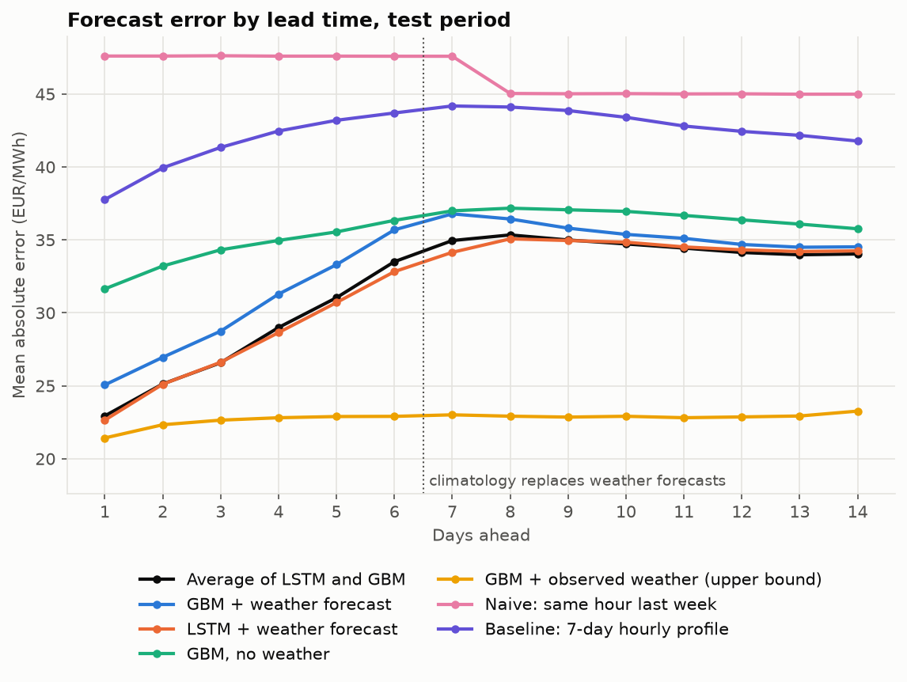

# Climate-Data-Project

Forecasting hourly day-ahead electricity prices up to two weeks ahead from weather,
and measuring how the forecast improves as newer weather forecasts arrive.

Current market: **Germany-Luxembourg (DE-LU)**. Everything market-specific lives in
`config/de_lu.yaml`.

## Results so far

Test period: forecasts issued daily from 1 March to 7 November 2026 (252 origins), each
predicting the next 14 days hour by hour. Mean absolute error in EUR/MWh; the mean price
over the test period was about 125. Every run is scored on the same delivery days.

| Model | Weather forecast | Trained from | All 14 days | Days 1-6 | Days 7-14 | vs naive |
|---|---|---|---|---|---|---|
| GBM + observed weather (upper bound) | observed | Apr 2024 | 22.5 | 22.3 | 22.7 | 0.49 |
| **LSTM** | Open-Meteo | Apr 2024 | **31.6** | **27.8** | 34.5 | 0.68 |
| **LSTM + GBM average** | GEFS + spread | Oct 2020 | **31.6** | 27.8 | **34.5** | 0.68 |
| LSTM | GEFS + spread | Apr 2024 | 31.8 | 28.0 | 34.6 | 0.69 |
| Combination of runs, chosen on validation | three runs | mixed | 32.1 | 28.4 | 34.8 | 0.69 |
| GBM + weather | GEFS + spread | Oct 2020 | 32.2 | 28.8 | 34.7 | 0.69 |
| GBM + weather | Open-Meteo | Apr 2024 | 33.2 | 30.2 | 35.4 | 0.72 |
| GBM, calendar and price history only | none | Apr 2024 | 35.6 | 34.3 | 36.6 | 0.77 |
| 7-day hourly profile | none | none | 42.4 | 41.4 | 43.1 | 0.92 |
| Same hour last week | none | none | 46.3 | 47.6 | 45.3 | 1.00 |

**[MODELS.md](MODELS.md)** compares every model and setting in detail: what each is good
and bad at, the effect of the weather source, the ensemble spread and the training window,
and what was tried and dropped.



- Weather carries most of the predictable signal. With perfect weather knowledge
  the error is half the naive error at every lead.
- With real forecasts, the gain is largest for days 1-3 and fades by about day 9.
  Open-Meteo's single high-resolution run is best for days 1-3, and the GEFS ensemble
  is best for days 5-8. Beyond that, neither beats climatology.
- Three setups tie for best (31.6): the Open-Meteo LSTM, and the average of the LSTM
  and GBM with GEFS for either training window. Differences under about 0.5 EUR/MWh
  are within noise with a single test period.
- The GEFS ensemble spread helps the LSTM a little (0.3-0.6) and the trees not at all.
- A weighted combination of runs, chosen on the validation period, didn't beat the
  best single model on the test period. Validation covers only one winter, and the
  models rank differently in winter and summer.

How one forecast changed as delivery approached (default GEFS run, the test day with
the largest revision, picked without looking at the outcome):


## How it works

**Data** (all free, no API keys):

| What | Source | Coverage |
|---|---|---|
| Day-ahead prices | [energy-charts.info](https://api.energy-charts.info) (Fraunhofer ISE, from SMARD) | hourly from Jan 2015 (joint zone with Austria until Sep 2018); 15-minute prices since Oct 2025 are averaged to hourly |
| Generation by source, load | energy-charts.info | hourly from Jan 2015 |
| Installed wind, solar, battery capacity | energy-charts.info | monthly from 2002 |
| Observed weather | [Open-Meteo](https://open-meteo.com) archive API (reanalysis) | hourly from Jan 2015 (available back to the 1940s) |
| Past and live weather forecasts (default) | [NOAA GEFS via dynamical.org](https://dynamical.org/catalog/noaa-gefs-forecast-35-day/) (Icechunk/Zarr on AWS Open Data, CC BY 4.0) | one 31-member ensemble run per day (00 UTC) from Oct 2020, 16 days ahead |
| Past weather forecasts (alternative) | Open-Meteo previous-runs API, GFS | what the model predicted 1-7 days before each hour, from Apr 2024 |
| Live weather forecast (alternative) | Open-Meteo forecast API, GFS | 16 days ahead; every download is kept as a snapshot |

**Forecast source.** `weather.forecast_source` in the config (or `--source`)
picks where weather forecasts come from:

- `gefs` (default): the NOAA GEFS ensemble. The store is read point by point, so
  only the chunks around the 14 locations are downloaded (about 40 MB and 20 s per
  daily run; the full archive from Oct 2020 took about 8.5 hours here and is about 640 MB
  on disk). Each run is reduced to the four national drivers per member, then to
  the ensemble mean and spread. Both are model inputs: the spread tells the model
  how far to trust the mean (`weather.gefs.use_spread`, or `--no-spread` to turn it
  off). Runs reach 16 days, so every target day sees a real forecast, and training
  can start in October 2020.
- `open_meteo`: the previous-runs archive, from April 2024 and only up to 7 days
  ahead, so target days 7-14 fall back to climatology.

Generation, load and capacity are collected but not yet used by the models.

Weather is pulled at 14 points and reduced to four national drivers: a wind
capacity-factor proxy (100 m wind through a generic turbine power curve, six
northern sites), solar irradiance (five southern/eastern sites), temperature at six
load centres, and precipitation.

**Forecast setup.** A forecast is made on the morning of day D, before the noon
auction. It knows prices through day D, observed weather through D-1, and weather
forecasts issued by the end of D-1. It predicts the 336 hourly prices of days
D+1 to D+14. For target day k the model sees the forecast issued k+1 days before;
with GEFS that is the 00 UTC run of day D-1 for every target day. Nothing in the
backtest uses information that was not available at the time
(`tests/test_features.py` and `tests/test_gefs.py` check this).

**Models.**

- `gbm_weather`: gradient-boosted trees, one pooled model over all leads.
- `lstm`: encoder-decoder LSTM. The encoder reads the last week of prices and
  weather; the decoder steps through the 336 target hours with the expected
  weather and calendar. Average of three seeds.
- `gbm_calendar`: the tree model without weather, to isolate what weather adds.
- `gbm_oracle`: the tree model given observed weather for all 14 days, an upper
  bound on what better weather forecasts could deliver.
- `ensemble`: the equal-weight average of `lstm` and `gbm_weather` from the same run.
- Combinations across runs: `climate-power combine` weighs models from several runs
  (sources, training windows, model types) by greedy forward selection on the
  validation period, then scores the result once on the test period.
  `forecast --combined` uses those weights live.

All models predict a correction to the last week's hour-of-day price profile, and
prices are normalised per forecast by the median and spread of the previous 28
days so that changes in the overall price level do not break them.

## Usage

Requires [uv](https://docs.astral.sh/uv/).

```bash
uv sync
uv run climate-power fetch      # download or refresh all data (first run: ~10 min, plus ~8-13 h for the GEFS archive)
uv run climate-power backtest   # train, evaluate, write reports/de_lu/
uv run climate-power forecast   # live 14-day forecast from the latest data
uv run pytest
```

The GEFS download can be interrupted and resumed: every finished run is stored
under `data/de_lu/gefs/raw/`, and the next `fetch` only gets what is missing.

Comparison runs: `--source open_meteo` switches the forecast source,
`--train-start YYYY-MM-DD` shortens the training window, and `--tag NAME` writes
models and reports to `models/de_lu/NAME/` and `reports/de_lu/NAME/` so they do
not overwrite the main run. For example:

```bash
uv run climate-power --source open_meteo fetch
uv run climate-power --source open_meteo --tag open_meteo backtest
uv run climate-power --source open_meteo snapshot   # archive the current Open-Meteo 16-day forecast
```

Combining runs: build the runs listed under `combine.runs` in the config (each entry
gives the options for that tag), then choose weights and forecast with them:

```bash
uv run climate-power --source open_meteo --tag open_meteo backtest
uv run climate-power --tag gefs_spread backtest
uv run climate-power --tag gefs_spread_from_2024 --train-start 2024-04-04 backtest
uv run climate-power combine               # weights from validation, test score in reports/de_lu/combined/
uv run climate-power forecast --combined   # live forecast from the weighted runs
```

Every backtest saves its validation and test forecasts to
`models/de_lu/<tag>/predictions.parquet`, which is what `combine` reads.

The LSTM trains on a CUDA GPU when PyTorch can see one, otherwise on the CPU.
Data and trained models are written to `data/` and `models/` and are not committed.

## Known limitations

- **Forecast history starts in October 2020.** Prices and observed weather go
  back to 2015, but the GEFS store starts with the current model version (GEFSv12)
  in October 2020. The same model version was re-run for 2000-2019 (the GEFSv12
  reforecast, 5 members), but only as global GRIB files on AWS, about 300 MB per
  day for the variables used here. With the Open-Meteo source, forecasts start in
  April 2024 and stop at 7 days ahead.
- **Conservative lead.** Using the run of day D-1 is up to a day staler than what
  is really available on the morning of day D (the 00 UTC run of day D is
  published by about 06 UTC).
- **Grid points, not interpolation.** GEFS values are taken at the nearest grid
  point (0.25 degrees; 100 m wind comes from the 0.5 degree grid), while observed
  weather comes from Open-Meteo's reanalysis. The models learn the mapping, but
  forecast and observation are not exactly the same quantity.
- **Single train/test split.** No rolling re-training yet, and the live command
  uses the models from the backtest rather than ones refitted on all data. The
  validation period is one winter (mid-Nov 2025 to mid-Feb 2026), so anything chosen
  on it, such as combination weights, may not carry over to summer. That is what
  happened with `combine`. It also means differences under about 0.5 EUR/MWh between
  models can't be told apart.
- **Default source is not the clear winner.** The default run (GEFS with spread,
  trained from 2020) is best used through its `ensemble` column. The Open-Meteo
  LSTM is just as good overall and better for days 1-3.
- **Point forecasts only.** No prediction intervals, and price spikes are
  under-predicted.
- **Weather only.** Gas and carbon prices, plant outages and cross-border flows
  are not modelled; the 28-day normalisation absorbs their slow movements only.
- **ERCOT is not included.** ERCOT's website and API reject connections from
  outside the US. Adding it needs a US connection or a third-party source such as
  gridstatus.io (free key), plus a Texas location list in a new config file.

## Ideas for next steps

- Rolling evaluation: retrain at several origins through 2024-2026, so models and
  combination weights are chosen and judged across every season, not one winter.
- Predict wind, solar and load first, then price from residual load. This stage
  needs only observed weather, so it can train on the full history from 2015 with
  installed capacity as an input.
- Quantile outputs for prediction intervals; the ensemble spread should matter
  more there than for point forecasts.
- Bring back the Fourier representative-day model as a baseline and as features.
- Extend the forecast history to 2015 with the GEFSv12 reforecast (same model
  version as the operational archive), reading only the needed GRIB messages via
  their `.idx` byte ranges.
